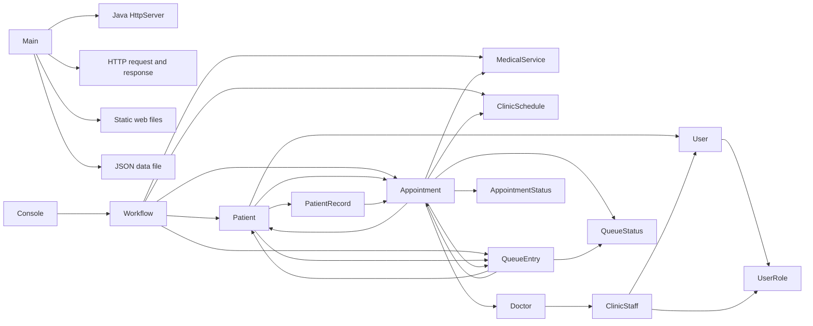

# 1.05 Sketch the Classes with CRC Cards

| | |
|---|---|
| *Project* | QueueLess Clinic Management System |
| *Task* | 1.05 Sketch the Classes with CRC Cards (3 points, Must) |

## How to read this document

Each card has three parts:

- *Class:* the name and its one-sentence job.
- *Responsibilities:* what the class knows and does to carry out that job.
- *Collaborators:* the other classes it works with.

*Extension point* marks where a future type or rule could be added and explains where it belongs.

---

## 1. Scope and class selection

The cards below cover every Java class and enum currently defined in `src/java`. `ClinicWorkflow` demonstrates the main patient-to-queue flow, and `ClinicConsole` provides a console entry point. The domain classes are included as implemented; the enums have cards because they define the valid role and status values used by the model classes.

| Kind | Classes |
|---|---|
| Application flow | `Main`, `ClinicConsole`, `ClinicWorkflow` |
| Accounts and people | `User`, `UserRole`, `Patient`, `ClinicStaff`, `Doctor` |
| Clinic data | `PatientRecord`, `MedicalService`, `ClinicSchedule` |
| Appointment and queue | `Appointment`, `AppointmentStatus`, `QueueEntry`, `QueueStatus` |

---

## 2. Class list at a glance

| # | Class | One clear job |
|---|---|---|
| 1 | Main | Start the web application and serve its pages and API over HTTP. |
| 2 | ClinicConsole | Accept a console choice and invoke the selected workflow. |
| 3 | ClinicWorkflow | Demonstrate patient registration, appointment booking, and queue entry creation. |
| 4 | User | Represent shared account identity and login information. |
| 5 | UserRole (enum) | Define the account roles recognized by the clinic system. |
| 6 | Patient | Represent a patient and maintain their appointment and queue associations. |
| 7 | ClinicStaff | Represent a clinic staff account. |
| 8 | Doctor | Represent a doctor with doctor-specific identification. |
| 9 | PatientRecord | Maintain patient information and appointment history. |
| 10 | MedicalService | Describe a clinic service offered to patients. |
| 11 | ClinicSchedule | Define clinic hours and validate appointment slots. |
| 12 | Appointment | Represent an appointment and enforce its status changes. |
| 13 | AppointmentStatus (enum) | Define the valid appointment states. |
| 14 | QueueEntry | Represent a patient's place and progress in the queue. |
| 15 | QueueStatus (enum) | Define the valid queue states. |

---

## 3. CRC cards

### Application flow

#### Card 1: Main

*Job:* Start QueueLess as a web application and serve its browser pages and JSON API over HTTP.

| Responsibilities | Collaborators |
|---|---|
| Provide the Java entry point and load the clinic data file | JSON data file |
| Select an available port and start the built-in HTTP server | `HttpServer` |
| Route API requests and serve static web files | `HttpExchange`, `Files` |

**Extension point: new API endpoint or web page.** Register the route and method in `Main.handle`; serve browser pages from `src/web`, and keep reusable clinic validation in the model classes.

#### Card 2: ClinicConsole

*Job:* Present a simple text menu and handle the user's selection.

| Responsibilities | Collaborators |
|---|---|
| Display the clinic console menu and read a choice | ClinicWorkflow |
| Run the clinic flow or exit based on the choice | ClinicWorkflow |
| Report an invalid menu choice | — |

**Extension point: new console action.** Add its menu choice and dispatch in `ClinicConsole`; keep the domain rules in the relevant model or workflow rather than in menu handling.

#### Card 3: ClinicWorkflow

*Job:* Demonstrate the main flow from creating a patient to adding their appointment to the queue.

| Responsibilities | Collaborators |
|---|---|
| Create sample patient and service objects | Patient, MedicalService |
| Select an appointment date and time and create an appointment | ClinicSchedule, Appointment |
| Create and associate a queue entry | QueueEntry, QueueStatus, Patient, Appointment |
| Print the resulting appointment and queue details | Patient, Appointment, QueueEntry |

**Extension point: additional clinic workflow.** Add the sequence and coordination here for a new demonstration flow, while keeping appointment and queue state validation in their respective classes.

### Accounts and people

#### Card 4: User

*Job:* Hold shared identity, contact, login, and role information for an account.

| Responsibilities | Collaborators |
|---|---|
| Know account ID, name, username, email, mobile, password hash, and role | UserRole |
| Match a supplied login identity against email, username, or mobile | — |
| Validate required account fields | — |

**Extension point: shared account detail or login identity.** Add common account data or matching behavior to `User`, then update subclasses or authentication code that consumes it.

#### Card 5: UserRole (enum)

*Job:* Define the roles that identify patient, clinic staff, and doctor accounts.

| Responsibilities | Collaborators |
|---|---|
| Provide the `PATIENT`, `CLINIC_STAFF`, and `DOCTOR` role values | User, Patient, ClinicStaff, Doctor |

**Extension point: new account role.** Add the role value here and update account creation and role checks to handle it.

#### Card 6: Patient

*Job:* Represent a registered patient and keep links to their record, appointments, and queue entries.

| Responsibilities | Collaborators |
|---|---|
| Know patient-specific information and category | User |
| Update patient information and manage profile details | — |
| Attach a patient record | PatientRecord |
| Book an owned appointment, cancel an eligible appointment, and view appointment history | Appointment |
| Keep associated queue entries | QueueEntry |

**Extension point: new patient profile field or patient action.** Put patient-specific information and behavior in `Patient`; update account registration, record handling, or related workflows wherever the new field or action is used.

#### Card 7: ClinicStaff

*Job:* Represent a clinic staff account with its staff identifier and staff role.

| Responsibilities | Collaborators |
|---|---|
| Inherit shared account identity and login data | User |
| Know the staff ID and validate an allowed staff role | UserRole |

**Extension point: staff-specific detail or responsibility.** Add shared staff behavior here; place doctor-only details in `Doctor` so staff and doctor roles remain distinct.

#### Card 8: Doctor

*Job:* Represent a doctor as a clinic staff account with a doctor identifier.

| Responsibilities | Collaborators |
|---|---|
| Reuse staff account information and role handling | ClinicStaff, UserRole |
| Know and validate the doctor ID | — |

**Extension point: doctor-specific detail or assignment.** Add doctor-only data here and link it to appointments if the system begins assigning appointments to a doctor.

### Clinic data

#### Card 9: PatientRecord

*Job:* Store patient information and a derived list of appointment history entries.

| Responsibilities | Collaborators |
|---|---|
| Know the record ID and patient information | Patient |
| Update patient information | Patient |
| Add appointments and refresh the appointment-history summary | Appointment |

**Extension point: new patient record detail.** Add the field and its update behavior to `PatientRecord`, then keep `Patient` and any record display or persistence flow in sync.

#### Card 10: MedicalService

*Job:* Describe one clinic service by its ID, name, and description.

| Responsibilities | Collaborators |
|---|---|
| Know and validate service details | Appointment |
| Provide service information for appointment selection or display | Appointment |

**Extension point: service category, duration, or availability.** Add service-specific data to `MedicalService` and update appointment selection or schedule validation that depends on it.

#### Card 11: ClinicSchedule

*Job:* Hold clinic operating hours, lunch break, and configured appointment slots, and check slot availability.

| Responsibilities | Collaborators |
|---|---|
| Know operating days, opening and closing times, lunch break, and slot list | Appointment |
| Check that a date and time are an available appointment slot | Appointment |
| Validate schedule and slot configuration | — |

**Current schedule:** Monday to Friday, 8:00 AM to 5:00 PM, with a lunch break from 11:00 AM to 1:00 PM and configured starts at 8:00, 9:00, 10:00 AM and 1:00, 2:00, 3:00, 4:00 PM.

**Extension point: new clinic-hours or slot rule.** Add configurable values and validation in `ClinicSchedule`; have `Appointment` continue using its slot-validation method rather than duplicating schedule checks.

### Appointment and queue

#### Card 12: Appointment

*Job:* Represent one patient's scheduled or walk-in visit and control its appointment lifecycle.

| Responsibilities | Collaborators |
|---|---|
| Know appointment ID, date, time, walk-in flag, and current status | AppointmentStatus |
| Link the appointment to its patient, service, schedule, doctor, and queue entry | Patient, MedicalService, ClinicSchedule, Doctor, QueueEntry |
| Validate its time slot when a schedule is provided | ClinicSchedule |
| Book, cancel, complete, mark no-show, or reassign according to allowed transitions | QueueEntry, QueueStatus |

**Current statuses:** Upcoming, Completed, Cancelled, Re-assigned, No-show.

**Extension point: new appointment state or transition rule.** Add the state to `AppointmentStatus`, then update transition validation and the relevant appointment action in `Appointment`. Keep queue updates coordinated with `QueueEntry`.

#### Card 13: AppointmentStatus (enum)

*Job:* Define the valid lifecycle states for an appointment.

| Responsibilities | Collaborators |
|---|---|
| Provide `UPCOMING`, `COMPLETED`, `CANCELLED`, `RE_ASSIGNED`, and `NO_SHOW` values | Appointment |

**Extension point: new appointment status.** Add the enum value here and implement its permitted transitions and effects in `Appointment`.

#### Card 14: QueueEntry

*Job:* Track one patient's queue number, position, waiting estimate, and queue progress.

| Responsibilities | Collaborators |
|---|---|
| Know queue number, position, status, and waiting estimate | QueueStatus |
| Link the queue entry to its patient and appointment | Patient, Appointment |
| Update queue position, waiting estimate, and allowed queue status | Patient, Appointment |
| Start checking, complete, mark no-show, or cancel the queue entry | QueueStatus, Appointment |

**Current statuses:** Waiting, Checking, Completed, No-show, Cancelled.

**Extension point: new queue state or estimate rule.** Add a queue state to `QueueStatus` and update allowed transitions in `QueueEntry`; place queue-wide ordering or wait-time calculations in a future queue coordinator if needed.

#### Card 15: QueueStatus (enum)

*Job:* Define the valid progress states for a queue entry.

| Responsibilities | Collaborators |
|---|---|
| Provide `WAITING`, `CHECKING`, `COMPLETED`, `NO_SHOW`, and `CANCELLED` values | QueueEntry, Appointment |

**Extension point: new queue status.** Add the enum value here and update `QueueEntry` transition logic and any appointment action that must keep the two states aligned.

---

## 4. Collaboration map

Arrows mean *uses or depends on*.

---

## 5. Where new types and rules slot in

| To add… | Change this | Collaborators / follow-up |
|---|---|---|
| A shared account field or login match | `User` | Update subclasses and authentication code that reads the account. |
| A new account role | `UserRole` | Update account construction and role checks; use the matching user subclass where needed. |
| A patient profile field | `Patient` | Update profile registration and `PatientRecord` if it belongs in the record. |
| A patient record field | `PatientRecord` | Update patient record creation and any display or persistence flow. |
| A clinic service detail | `MedicalService` | Update service selection and appointment display. |
| A schedule or appointment-slot rule | `ClinicSchedule` | Update appointment slot validation through `Appointment`. |
| An appointment state or transition | `AppointmentStatus` and `Appointment` | Coordinate corresponding queue changes in `QueueEntry` and `QueueStatus`. |
| A queue state or transition | `QueueStatus` and `QueueEntry` | Update appointment actions that must stay synchronized. |
| Doctor assignment behavior | `Appointment` | Add assignment rules and keep doctor-specific information in `Doctor`. |
| A new console option | `ClinicConsole` | Dispatch to a workflow; keep domain validation in the domain classes. |
| A new end-to-end demonstration flow | `ClinicWorkflow` | Compose existing domain objects and methods in the required order. |
